# 实验室设备预约与智能报修平台 课程设计文档

## 1 项目概述

### 1.1 项目背景

实验室设备的预约、使用与故障报修通常分散在纸质登记本、即时通讯群和人工口头沟通中，由此产生三个具体问题：
设备信息难以快速检索，预约状态不透明导致时段冲突，故障处理进度无法追踪。同时，设备说明书与安全规范以文件形式零散保存，
师生在遇到报错代码或异常现象时难以快速定位到对应的处理条款。

本项目实现一个面向高校实验室的轻量级 Web 系统，把设备台账、预约申请与审核、故障报修与处理、知识问答集中在同一平台，
并引入检索增强生成（RAG）与智能体（Agent）能力，使"查资料—查设备—报修—跟踪"形成完整闭环。

### 1.2 项目目标

1. 建立可检索的设备台账，展示编号、类别、实验室、位置、状态与使用说明；
2. 支持预约申请、审核、取消与完成的状态管理，并在提交与批准两个环节校验时间冲突；
3. 支持故障报修全流程：提交、受理、处理记录、完成或关闭，处理轨迹可回溯；
4. 基于设备手册与安全规范构建知识库，回答需附带可定位的来源片段，资料不足时明确说明；
5. 通过 LangChain Agent 调用受控业务工具，创建报修单前必须由用户确认，确认后由后端写入真实数据；
6. 交付可现场演示、可重复测试、可被教师核验的前后端与数据库完整工程。

### 1.3 范围与边界

| 范围内（本期实现） | 范围外（本期不实现） |
| --- | --- |
| 账号登录与角色权限；设备台账查询与维护；预约申请、审核、取消、完成；报修提交、受理、处理、完成与关闭；知识库上传、索引与问答；Agent 查询设备与确认后建单 | 统一身份认证；物联网传感器接入；自动排课与复杂资源调度；财务结算与采购库存；移动端原生应用；生产级多租户与高可用 |

课程原型把"实验室管理员"与"维修人员"合并为单一管理员角色，减少权限与页面工作量；多模态能力（图片识别）不纳入本期主链路。

## 2 需求分析

### 2.1 用户角色与权限

| 角色 | 主要职责 | 权限范围 |
| --- | --- | --- |
| 普通用户（学生/教师） | 查询设备、提交预约、提交报修、查看本人记录、使用知识问答与智能助手 | 仅访问公开设备信息与本人业务记录，不可审核或修改他人记录 |
| 管理员（兼维修人员） | 维护设备、审核预约、受理与处理工单、维护知识库 | 可管理全部设备与业务记录，可查看 AI 执行轨迹 |

权限实现原则：前端菜单隐藏仅用于界面引导，**所有数据权限与操作权限均由后端接口再次校验**；普通用户访问 `/admin/**` 一律返回 403。

### 2.2 核心业务流程

**设备预约流程**：用户查看设备 → 选择起止时间提交申请（校验时间规则与已批准预约冲突）→ 管理员审核（批准前再次校验冲突）
→ 用户在"我的预约"查看结果 → 预约结束后管理员标记完成；审核前用户可自行取消。

**故障报修流程**：用户选择设备并填写故障描述 → 系统生成唯一工单号，状态"待受理" → 管理员受理，状态"处理中"
→ 管理员填写处理记录并完成，或对无效工单关闭并说明原因 → 用户在"我的报修"查看状态与处理轨迹。

**AI 问答与智能建单流程**：用户提问 → 系统检索知识片段并生成带来源的回答 → 用户请求智能助手准备报修
→ Agent 调用设备查询与建单预览工具 → 展示待提交内容 → 用户确认后由后端创建工单并返回真实工单号。

### 2.3 功能需求

| 编号 | 需求描述 | 优先级 |
| --- | --- | --- |
| FR-01~03 | 登录与登出、普通用户与管理员角色区分、本人记录的数据归属校验 | P0 |
| FR-04~06 | 设备分页与筛选、详情字段完整、管理员新增编辑与状态切换、编号唯一 | P0 |
| FR-07~11 | 预约提交与时间规则校验、冲突检测、本人列表与取消、管理员审核留痕、结束后标记完成 | P0（FR-11 为 P1） |
| FR-12~15 | 报修提交与唯一工单号、本人工单查询、管理员受理与结果填写、状态变更轨迹 | P0（FR-15 为 P1） |
| FR-16~19 | 知识文档上传与格式校验、解析切分与索引重建、问答带来源引用、会话上下文 | P0（FR-19 为 P1） |
| FR-20~23 | Agent 查询与建单工具、写操作确认、失败提示与手动兜底、执行事件记录 | P0（FR-23 为 P1） |

### 2.4 非功能需求

| 类别 | 要求 |
| --- | --- |
| 易用性 | 清晰导航；表单字段有校验与错误提示；关键操作可取消或二次确认 |
| 性能 | 演示数据规模下常规接口响应 ≤3 秒（不含模型推理）；AI 请求设置超时并提示 |
| 安全 | BCrypt 存储密码；JWT 鉴权；参数化查询；上传类型与大小限制；密钥不入库不入仓 |
| 可靠性 | 写操作失败不产生部分成功；Agent 建单幂等；AI 不可用不影响基础业务 |
| 可维护性 | 前后端分层；AI 工具与业务接口边界清晰；提供初始化脚本、配置模板与启动脚本 |

### 2.5 验收场景

需求文档第 7 章定义的 AT-01~AT-11 全部实现并自动化验证，覆盖设备查询、预约闭环、冲突拦截、报修流转、
越权拒绝、RAG 引用、证据不足、新增文档检索、Agent 取消与确认建单、模型不可用降级。

## 3 概要设计

### 3.1 总体架构

系统采用四层结构，AI 能力作为独立服务接入，业务规则始终由后端掌握：

| 层次 | 组成 | 职责 |
| --- | --- | --- |
| 表现层 | Vue 3 + Vite + Element Plus | 页面渲染、表单校验、会话式交互、状态展示 |
| 业务层 | Spring Boot 3.5 + Spring Data JPA | 鉴权、权限、业务规则、事务、状态机、AI 网关、操作留痕 |
| 数据层 | MySQL 8.0 | 用户、设备、预约、工单、知识分片、会话与执行轨迹 |
| 智能层 | Python FastAPI + LangChain + Chroma | 文档解析切分、向量化与混合检索、Prompt 编排、工具调用循环 |

关键边界约定：

1. 浏览器只与本系统后端通信，AI 服务不直接暴露给前端；
2. AI 服务通过 `X-Internal-Token` 调用后端 `/internal/tools/**` 的只读工具与建单前校验接口；
3. **AI 服务没有任何写接口**，工单写入必须由后端在用户确认后执行；
4. AI 服务不可用时，设备、预约、手动报修等功能全部可用。

### 3.2 技术选型

| 部分 | 选型 | 选择理由 |
| --- | --- | --- |
| 前端 | Vue 3 + Vite + Element Plus + Pinia + Vue Router | 组合式 API 开发效率高，Element Plus 组件覆盖后台管理场景 |
| 后端 | Spring Boot 3.5.16（Java 21）+ Spring Data JPA | 生态成熟，事务与 JPA 规范清晰，便于演示分层设计 |
| 认证 | 自实现 HS256 JWT + 拦截器 | 仅需 JDK 加密库，避免引入完整 Spring Security 过滤器链的复杂度 |
| 数据库 | MySQL 8.0（InnoDB，utf8mb4） | 课程固定选型，支持事务与行锁，便于演示并发控制 |
| AI 服务 | FastAPI + LangChain 1.x + Chroma | LangChain 负责 Prompt 与工具编排，Chroma 提供持久化向量检索 |
| 向量化 | 字符 n-gram 哈希向量 + BM25 重排 | 无需下载句向量模型即可离线重建索引，演示环境可复现 |
| 大模型 | DeepSeek（OpenAI 兼容接口，`deepseek-flash`） | 接口兼容、中文效果好；未配置 Key 时自动降级为检索摘要 |

### 3.3 模块划分

| 模块 | 主要类 | 说明 |
| --- | --- | --- |
| 认证与权限 | `AuthController`、`AuthService`、`JwtUtil`、`AuthInterceptor` | 登录签发令牌、请求级用户上下文、角色与归属校验 |
| 设备管理 | `EquipmentController`、`AdminEquipmentController`、`EquipmentService` | 台账查询、维护、状态切换 |
| 预约管理 | `ReservationController`、`AdminReservationController`、`ReservationService` | 时间规则、冲突检测、审核与状态流转 |
| 报修管理 | `RepairController`、`AdminRepairController`、`RepairService` | 工单生命周期与处理轨迹 |
| 知识库 | `KnowledgeController`、`KnowledgeService` | 文件上传、解析调用、分片入库、索引重建 |
| AI 网关 | `AiController`、`AiService`、`AiClient` | 会话管理、调用 AI 服务、确认动作持久化 |
| 内部工具 | `InternalToolController` | 供 AI 服务查询设备、校验建单参数（只读） |
| RAG 管道 | `app/rag/pipeline.py`、`store.py`、`text.py`、`embeddings.py` | 解析、切分、向量化、混合检索、生成 |
| Agent 编排 | `app/agent/runner.py`、`tools.py` | 工具定义、调用循环、降级编排、确认提案 |

### 3.4 部署结构

三个进程运行在同一台演示机器上：

| 进程 | 端口 | 启动方式 |
| --- | --- | --- |
| Vue 前端（Vite） | 5173 | `npm run dev`，`/api` 反向代理到 8080 |
| Spring Boot 后端 | 8080（上下文 `/api`） | `java -jar labcare-backend.jar` |
| FastAPI AI 服务 | 8100 | `uvicorn app.main:app` |

前端通过 Vite 代理访问后端，避免浏览器跨域；后端通过 HTTP 访问 AI 服务，通过 MySQL JDBC 访问数据库。

### 3.5 目录结构

```
src/frontend         Vue3 前端（views / api / stores / router）
src/backend          Spring Boot 后端（controller / service / repository / domain / dto / security）
src/ai-service       AI 服务（app/rag 检索管道、app/agent 工具编排）
db/init.sql          建库建表与种子数据
data/知识库          RAG 语料；data/测试数据 验收输入
evidence            运行截图、Agent 轨迹、RAG 验证、测试输出
```

## 4 开发工具

| 工具 | 版本 | 用途 |
| --- | --- | --- |
| IntelliJ IDEA / VS Code | 2024.x / 1.9x | 代码开发与调试 |
| JDK | 21.0.5 | 后端编译与运行 |
| Maven | 3.9.9 | 依赖管理与打包 |
| Node.js / npm | 24.15.0 / 12.0.2 | 前端构建 |
| Python | 3.14.4 | AI 服务运行 |
| MySQL | 8.0.46 | 数据存储 |
| Git | 2.53 | 版本管理 |
| Postman / 自研脚本 | — | 接口联调与回归（`tests/api_smoke.py`） |
| Chrome + Puppeteer | 156 | 端到端 UI 冒烟与截图（`src/frontend/scripts/ui_smoke.mjs`） |

## 5 详细设计

### 5.1 数据库设计

共 11 张表。核心表结构如下（完整定义见 `db/init.sql`）：

**app_user（用户）**

| 字段 | 类型 | 说明 |
| --- | --- | --- |
| id | BIGINT UNSIGNED PK | 主键 |
| username | VARCHAR(50) UNIQUE | 登录名 |
| password_hash | VARCHAR(100) | BCrypt 摘要，禁止明文 |
| display_name | VARCHAR(50) | 显示名 |
| role | VARCHAR(20) | USER / ADMIN |
| status | TINYINT | 1 启用，0 停用 |
| created_at / updated_at | DATETIME | 时间戳 |

**equipment（设备）**：`code` 业务唯一；`status` 取 AVAILABLE / MAINTENANCE / DISABLED；`lab`、`location`、`usage_note` 支撑详情页。

**reservation（预约）**：`code` 唯一；`equipment_id`、`user_id`、`start_time`、`end_time`、`purpose`；
`status` 取 PENDING / APPROVED / REJECTED / CANCELLED / COMPLETED；审核人、审核意见、审核时间单独留痕。

**repair_ticket（报修工单）**：`code` 唯一；`description`、`contact`、`status`（PENDING / PROCESSING / COMPLETED / CLOSED）、
`handler_id`、`resolution`、`accepted_at`、`completed_at`、`source`（MANUAL / AGENT）。

**pending_action（待确认动作）**：`token` 唯一、`payload` JSON、`status`、`expires_at`、`result_ref`，
用于 Agent 建单的一次性确认，过期时间默认 10 分钟。

其余表：`operation_log`（关键操作留痕）、`knowledge_document`、`knowledge_chunk`（分片原文，用于引用与重建）、
`chat_session`、`chat_message`、`agent_run`（工具调用轨迹）。

索引设计：`reservation(equipment_id, start_time, end_time)` 支撑冲突查询；`repair_ticket(user_id)`、`(status)` 支撑列表筛选；
`knowledge_chunk(document_id, chunk_index)` 支撑分片读取。

### 5.2 接口设计

后端统一前缀 `/api`，响应结构 `{code, message, data, timestamp}`，`code=0` 表示成功。主要接口：

| 方法 | 路径 | 说明 |
| --- | --- | --- |
| POST | `/auth/login` | 登录，返回 JWT 与用户信息 |
| GET | `/auth/me` | 当前用户 |
| GET | `/equipments` | 设备分页查询（keyword/category/laboratory/status） |
| GET | `/equipments/{id}` | 设备详情 |
| POST | `/reservations` | 提交预约 |
| GET | `/reservations/mine` | 本人预约列表 |
| POST | `/reservations/{id}/cancel` | 取消本人待审核预约 |
| POST | `/admin/reservations/{id}/review` | 审核（通过/驳回 + 意见） |
| POST | `/admin/reservations/{id}/complete` | 标记完成 |
| POST | `/repairs` | 提交报修 |
| GET | `/repairs/mine` | 本人工单 |
| POST | `/admin/repairs/{id}/accept` | 受理 |
| POST | `/admin/repairs/{id}/progress` | 更新处理记录 |
| POST | `/admin/repairs/{id}/complete` | 完成（必须填写结果） |
| POST | `/admin/repairs/{id}/close` | 关闭（必须填写原因） |
| POST | `/admin/knowledge/upload` | 上传知识文档（≤10MB） |
| POST | `/admin/knowledge/reindex` | 重建索引 |
| POST | `/ai/chat` | RAG 问答 |
| POST | `/ai/agent/chat` | Agent 对话（可返回待确认提案） |
| POST | `/ai/agent/confirm` | 确认或取消建单 |
| GET | `/internal/tools/equipments` | 内部工具：设备查询（服务间令牌） |
| POST | `/internal/tools/repairs/prepare` | 内部工具：建单前校验（只读） |

### 5.3 鉴权与权限设计

登录成功后签发 HS256 JWT，载荷包含用户 id、用户名、显示名、角色与过期时间；前端将令牌放入 `Authorization: Bearer`。
`AuthInterceptor` 对所有 `/api/**` 生效（登录与健康检查除外），解析失败返回 401；`/admin/**` 额外校验角色，非管理员返回 403；
`/internal/**` 校验 `X-Internal-Token`。业务层再以 `UserContext.require()` 的 id 判断数据归属，避免信任前端参数。

### 5.4 预约冲突控制

时间规则由配置驱动：30 分钟粒度、至少提前 30 分钟、最多提前 7 天、单次 0.5~4 小时。

冲突判定 SQL 语义为：同一设备、状态为 `APPROVED`、且 `existing.start < new.end AND existing.end > new.start`。

并发控制采用两级措施：提交与批准时对设备行加悲观锁（`SELECT ... FOR UPDATE`），把同一设备的并发请求串行化；
批准时在锁内再次查询冲突（排除自身）。待审核申请按需求约定不占用时段，因此不会互相阻塞，但先批准者先占用。

### 5.5 工单状态机

```
PENDING --受理--> PROCESSING --完成--> COMPLETED
   |                   |
   +------关闭---------+--> CLOSED
```

所有流转在 `RepairService` 中显式校验，非法跳转返回 409 并给出当前状态；每次流转写入 `operation_log`，
工单详情按时间顺序返回处理轨迹，满足 FR-15 的可追溯要求。

### 5.6 RAG 管道设计

1. **解析**：支持 txt / md / pdf / docx，分别使用内置解码、pypdf、python-docx 提取文本；
2. **切分**：`RecursiveCharacterTextSplitter`，块大小 320 字、重叠 60 字，分隔符包含中文标点；
3. **向量化**：字符 2~3 gram 的哈希向量（2048 维，L2 归一化），无需下载模型即可离线重建；
4. **存储**：Chroma 持久化集合，metadata 保存 `document_id`、`document_title`、`chunk_index`，分片原文同时落 MySQL 便于引用；
5. **检索**：向量召回 Top-10 后与 BM25 词法分数加权（0.45/0.55）重排，取 Top-4；
6. **生成**：把编号片段注入 Prompt，要求仅依据资料作答、以 `[1][2]` 标注来源；资料不足或涉及安全时明确拒绝推断；
7. **降级**：未配置模型 Key 或调用失败时，返回检索原文摘要并标注"降级模式"，检索与来源仍然真实。

证据不足判定：若最佳片段的查询词覆盖率低于 34% 且 BM25 得分为 0，则直接回答"现有资料无法确认"，不生成推测结论（AT-07）。

### 5.7 Agent 工具调用与确认机制

工具清单（白名单）：

| 工具 | 参数 | 作用 |
| --- | --- | --- |
| `search_equipment` | keyword | 调用后端内部接口查询设备 |
| `get_equipment` | equipment_id | 查询设备详情与使用说明 |
| `prepare_repair` | equipment_id、description、contact | 后端校验参数并生成确认文案，**不写库** |

执行流程：LangChain 绑定工具后进入 tool-calling 循环（最多 4 轮），每次工具调用写入 `agent_run`；
若调用 `prepare_repair`，后端生成一次性 `pending_action`（UUID token，10 分钟过期），前端展示确认卡片。

确认接口按以下顺序处理：令牌存在性 → 归属校验 → 是否已确认（幂等，重复确认返回原工单号）→ 是否过期 →
用户选择取消则置为 CANCELLED 且不写业务数据 → 选择确认则以当前登录用户身份调用 `RepairService.create`，
将 `source` 标记为 `AGENT`，写入 `result_ref` 并返回真实工单号。

未配置模型时，Agent 走确定性规则编排：按设备编号/名称匹配 → 判断报修意图 → 调用同一批工具生成预览，
保证"工具调用真实、写入仍需确认"，不会因为缺少模型而伪造结果。

## 6 运行结果

以下截图为系统实际运行画面（`evidence/运行截图或录屏/`）。

### 6.1 登录与工作台

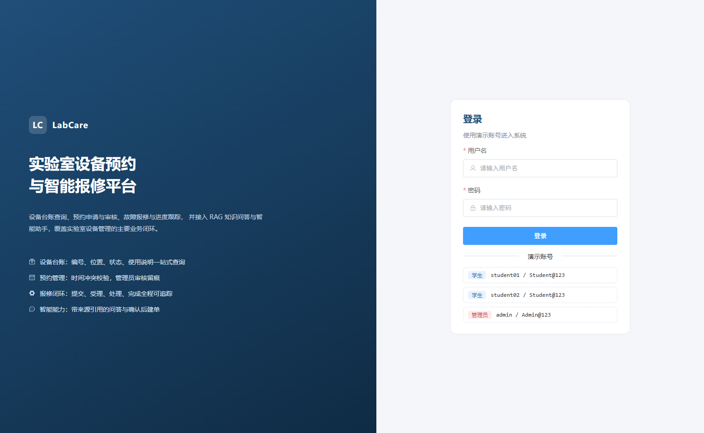

登录页提供三个演示账号（两名普通用户、一名管理员），点击即可填充。

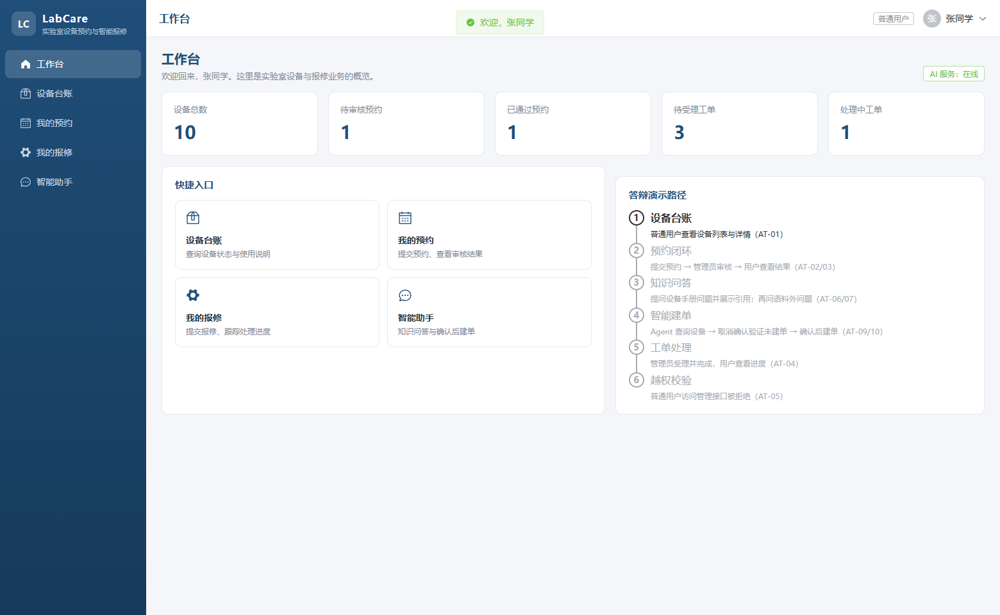

工作台展示设备总数、待审核预约、待受理与处理中工单等统计，并给出答辩演示路径。

### 6.2 设备台账与详情

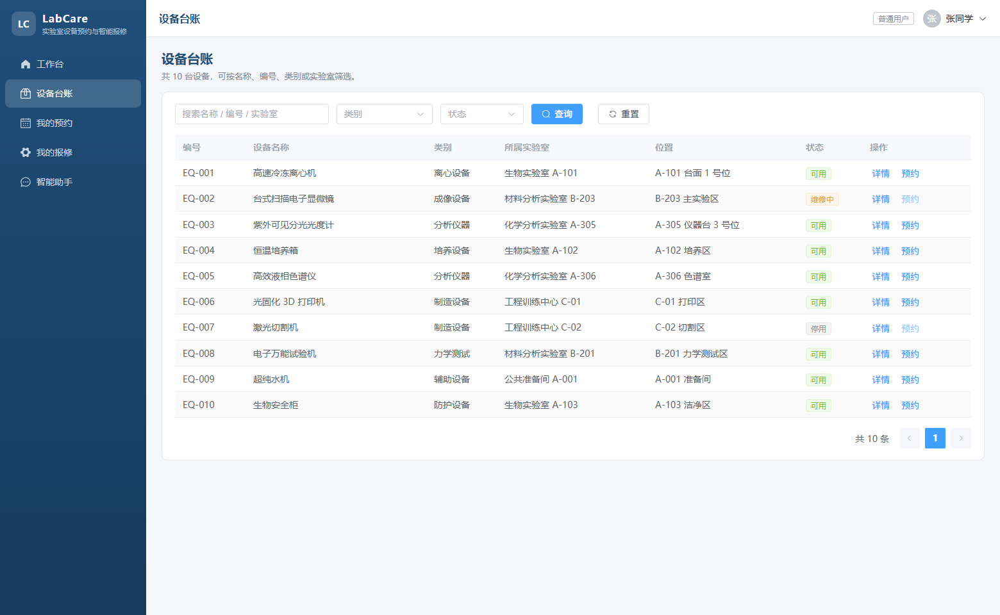

设备列表支持按名称、编号、实验室关键词与状态筛选，停用设备不可发起预约。

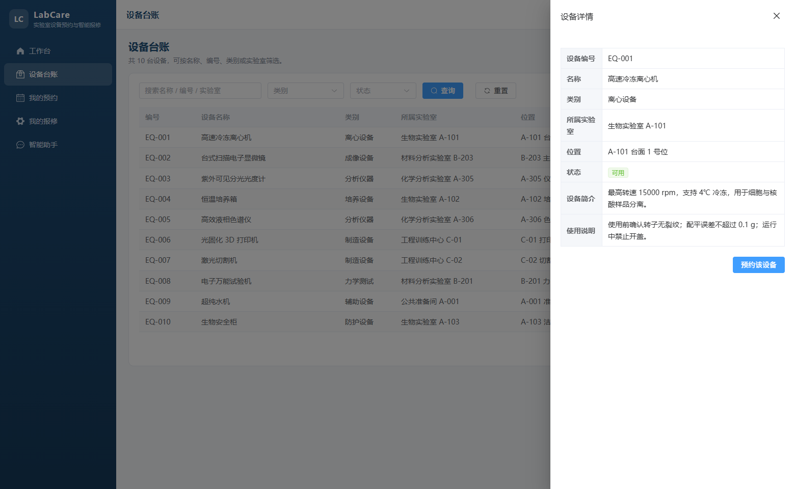

详情抽屉展示编号、类别、实验室、位置、状态、简介与使用说明，与列表字段一致。

### 6.3 预约与审核

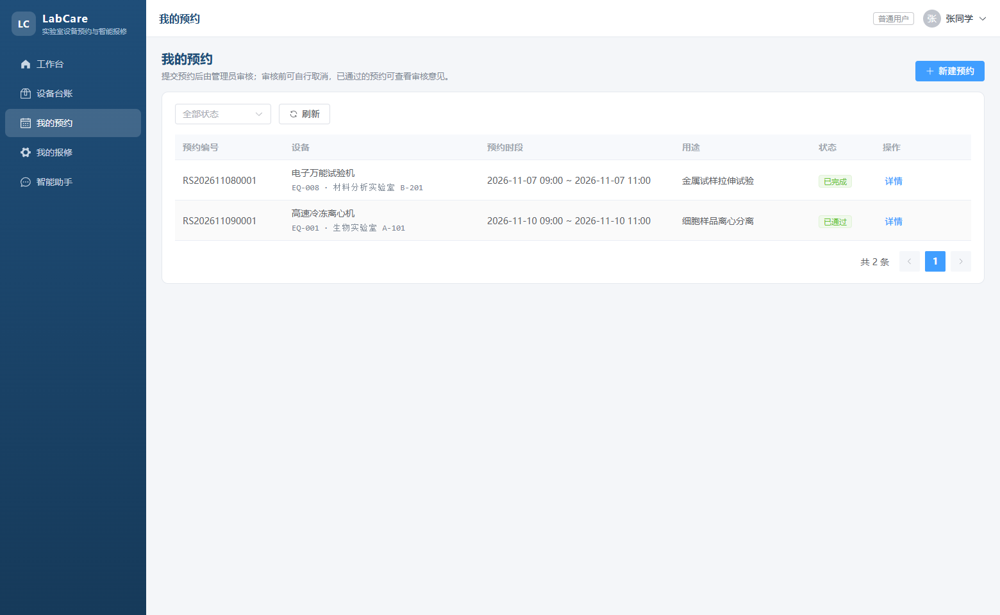

预约提交后进入"待审核"，管理员批准后用户可看到审核人与审核意见；冲突申请在提交时即被拦截并提示冲突单号。

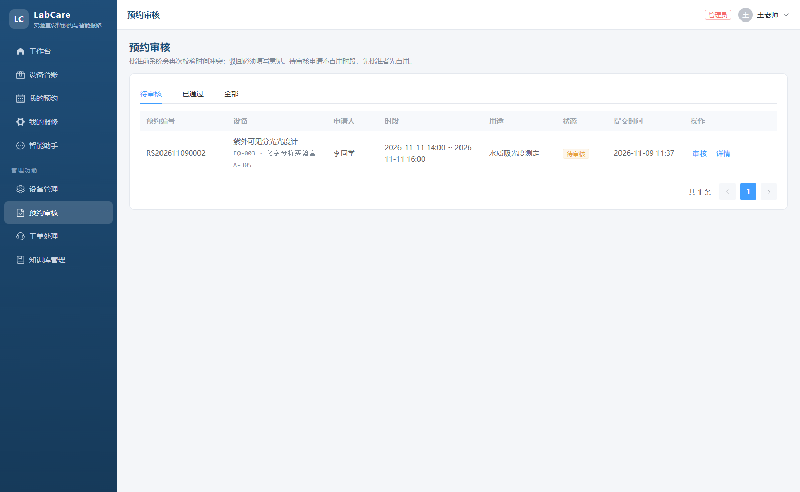

管理员在审核弹窗中选择通过或驳回，驳回必须填写意见；批准时后端会在设备行锁内再次校验冲突。

### 6.4 RAG 知识问答

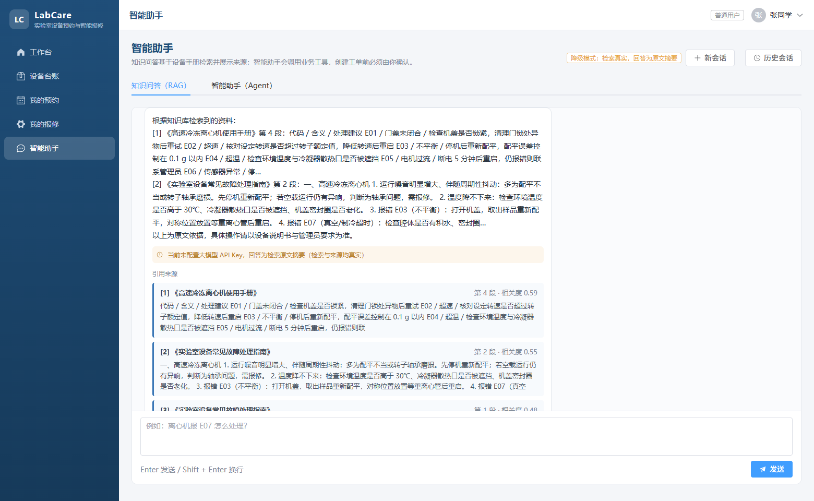

回答下方列出引用来源（文档标题、片段序号、相关度与原文摘要）。系统未配置模型 Key 时以"降级模式"标注，
仍展示真实检索结果（上图即为降级模式，回答为原文摘要）。

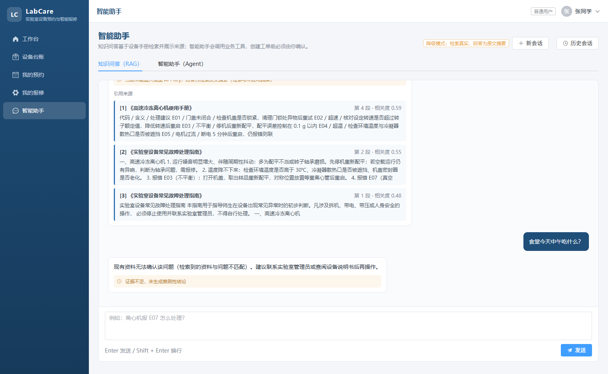

对知识库未覆盖的问题（如"食堂今天中午吃什么"），系统明确回答"现有资料无法确认"，不编造结论。

### 6.5 Agent 智能助手

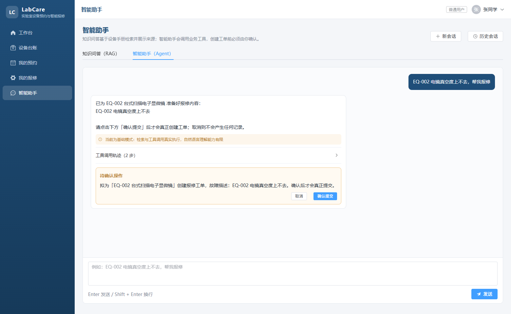

Agent 调用设备查询与建单预览工具后，展示待提交内容与"确认提交/取消"按钮，此时数据库中没有新工单。

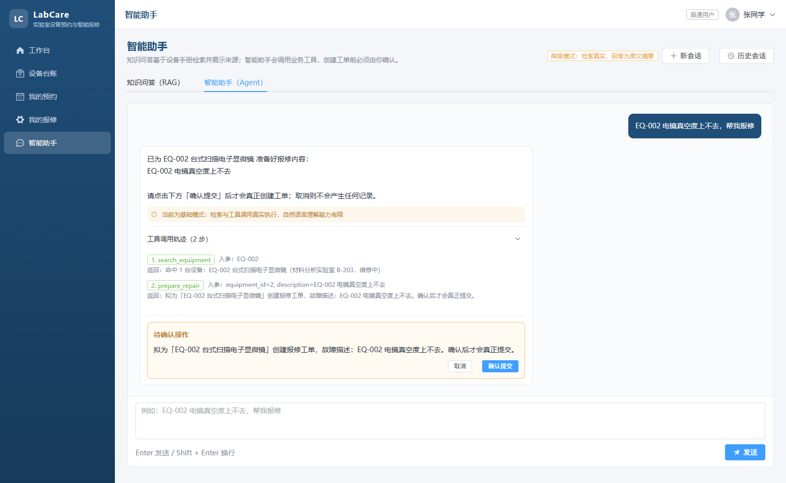

每次工具调用的入参、返回值与成功状态可在页面展开查看，同时写入 `agent_run` 表。

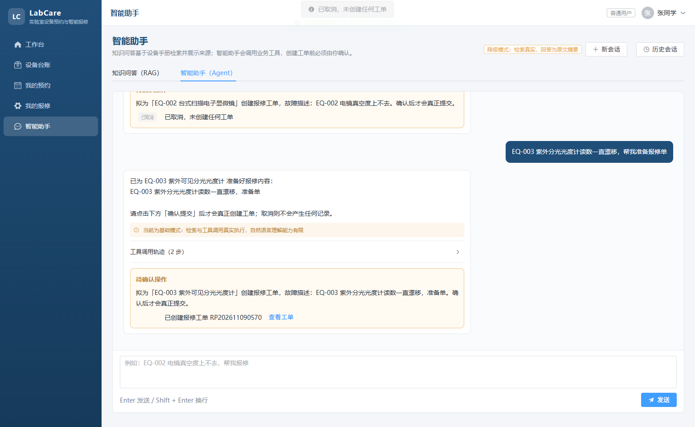

确认后返回真实工单号，工单来源标记为"智能助手"，可在"我的报修"与管理员工单列表中查到同一条记录。

### 6.6 管理端


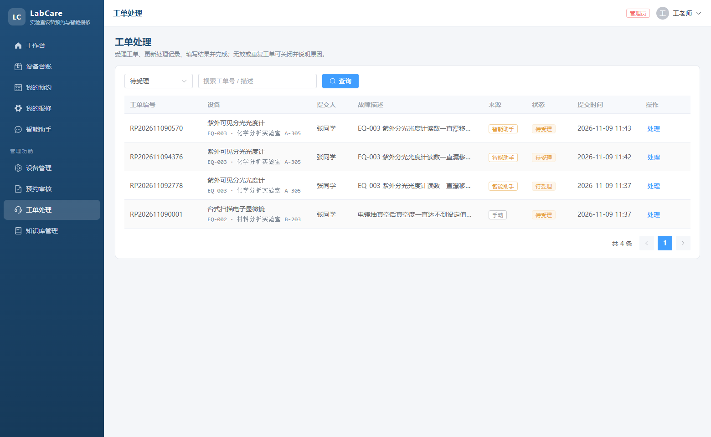

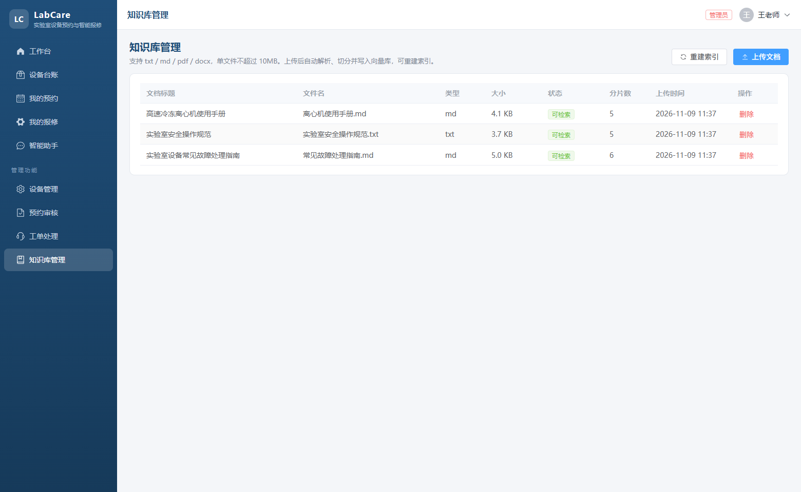

管理员可完成预约审核、工单受理与完成、知识文档上传与索引重建；知识库列表展示处理状态与分片数。

## 7 调试分析

开发过程中遇到并解决的问题：

| 现象 | 原因 | 解决方式 |
| --- | --- | --- |
| 后端 jar 启动报 `UnsupportedClassVersionError` | PATH 上的 `java` 为 8，而工程以 Java 21 编译 | 启动脚本优先使用 `JAVA_HOME\bin\java.exe`，并在 README 注明 JDK 21 要求 |
| 启动脚本用 `mvn` 正常、直接 `java -jar` 失败 | 同上，属于运行时与编译时 JDK 不一致 | 同上，并统一在 `scripts/start-backend.ps1` 中固定 Java 路径 |
| 前端 Agent 请求返回 400 "question 不能为空" | 问答接口使用 `question` 字段，助手接口复用了同一 DTO 却传 `message` | 拆分 `AgentChatRequest`，接口与前端字段对齐 |
| AI 服务停止时前端提示"服务异常"而非"AI 服务不可用" | 业务异常 503 被统一映射为 400 | 全局异常处理补充 503 映射，前端拦截器单独提示 |
| npm 安装依赖长时间卡住 | 用户级 `.npmrc` 配置了已失效的本地代理 `127.0.0.1:7890` | 使用干净的 `--userconfig` 与国内镜像安装，并在 README 记录排查方法 |
| Puppeteer 输入中文/英文混合文本丢失前缀 | 切换页签后 Vue 重渲染与逐字符输入竞争 | 自动化脚本改为直接设值并派发 `input` 事件，同时断言输入内容 |
| 同一设备并发批准产生重复占用 | 冲突校验与更新之间存在竞态 | 对设备行加 `PESSIMISTIC_WRITE` 锁，在锁内二次校验冲突 |
| 知识库首次检索为空 | 文档元数据存在但未建立向量索引 | 后端启动时异步同步索引，并提供管理员"重建索引"按钮兜底 |
| 分片原文含 Markdown 表格，问答可读性差 | 检索片段直接回显原文 | 增加片段清洗：去除表格分隔线、标题井号，表格转为" / "分隔 |
| 预约编号重复 | 日期 + 随机数可能碰撞 | 生成后查重并重试，最多 20 次，仍失败则抛出明确异常 |

## 8 测试与验收结果

### 8.1 自动化结果

| 测试集 | 覆盖范围 | 结果 |
| --- | --- | --- |
| `tests/api_smoke.py` | AT-01~AT-11 共 26 项接口级检查 | 26/26 通过 |
| `tests/ai_down_check.py` | AI 服务停机后的降级行为 | 4/4 通过（问答返回 503，基础业务仍可用） |
| `src/frontend/scripts/ui_smoke.mjs` | 16 项浏览器端到端检查 | 16/16 通过，控制台错误 0 条 |

详细用例与结果见 `测试结果.xlsx`，原始报告见 `evidence/测试与构建/`。

### 8.2 典型验收观察点

- 预约冲突：重叠申请会被拒绝并给出冲突单号；待审核申请互不占用时段。
- 越权访问：普通用户访问 `/admin/**` 或他人记录均返回 403，未登录返回 401。
- RAG 溯源：回答下方可定位到具体文档与片段序号；新上传文档经索引后可被检索到。
- Agent 写操作：取消确认后工单数量不变；确认后返回真实工单号且可幂等重复调用。
- 降级：停止 AI 服务后，设备查询与手动报修仍正常，问答接口明确返回不可用。

## 9 总结与改进

本项目完成了从需求到实现再到验收的完整链路，主要工作与收获：

1. **业务规则先于界面**：预约冲突、状态机、权限校验都落在后端，前端只负责展示与交互，越权与非法状态在接口层即被拒绝；
2. **AI 能力必须可解释、可兜底**：RAG 强制引用来源并对"无答案"显式拒答，Agent 只做提案、由用户确认后由后端写库，
   模型不可用时业务不受影响；
3. **可验证性设计**：把验收场景写成脚本，配合截图与报告，使"功能是否真的可用"可被重复核验。

存在的不足与后续改进方向：

- 检索使用哈希向量 + BM25，语义泛化能力弱于句向量模型，可替换为本地 embedding 模型并保留 BM25 混合策略；
- 未实现站内通知与邮件提醒，预约到期、工单状态变化依赖用户主动查看；
- 并发控制目前以设备行锁串行化，数据量增大后可改为唯一约束 + 时间区间索引；
- 多模态能力（故障照片识别）未纳入主链路，可作为加分项扩展。

## 10 参考文献

1. Spring Boot Reference Documentation, VMware Tanzu, 2025.
2. Vue.js 官方文档（组合式 API），https://cn.vuejs.org/
3. Element Plus 组件库文档，https://element-plus.org/zh-CN/
4. LangChain Documentation, https://python.langchain.com/
5. Chroma 向量数据库文档，https://docs.trychroma.com/
6. MySQL 8.0 Reference Manual, Oracle, 2025.
7. Lewis P, et al. Retrieval-Augmented Generation for Knowledge-Intensive NLP Tasks. NeurIPS 2020.
8. Robertson S, Zaragoza H. The Probabilistic Relevance Framework: BM25 and Beyond. 2009.

## 附录 A 启动步骤

```powershell
# 1. 初始化数据库
mysql -u root -p --default-character-set=utf8mb4 < db/init.sql

# 2. 填写本地配置
Copy-Item config/local.env.example config/local.env   # 填 MySQL 密码与模型 Key（可留空）

# 3. 一键启动（AI 服务 8100 / 后端 8080 / 前端 5173）
.\scripts\start-all.ps1

# 4. 浏览器访问
http://localhost:5173
```

## 附录 B 演示账号

| 账号 | 密码 | 角色 |
| --- | --- | --- |
| student01 | Student@123 | 普通用户（张同学） |
| student02 | Student@123 | 普通用户（李同学） |
| admin | Admin@123 | 管理员（王老师） |

## 附录 C 已知限制

1. 演示环境为单机三进程，未做容器化与高可用；
2. 知识库单文件限制 10MB，暂不支持扫描版 PDF（无 OCR）；
3. 未配置模型 Key 时问答为检索摘要模式，界面会明确标注；
4. 预约时段以服务器本地时区（Asia/Shanghai）为准。
